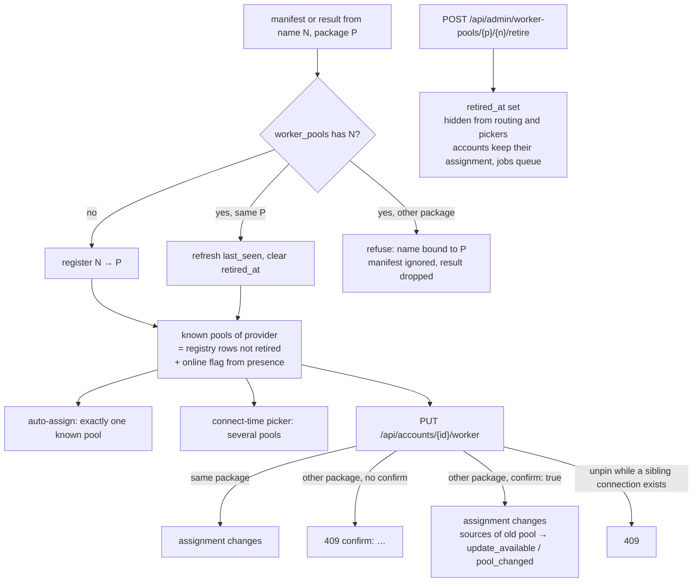
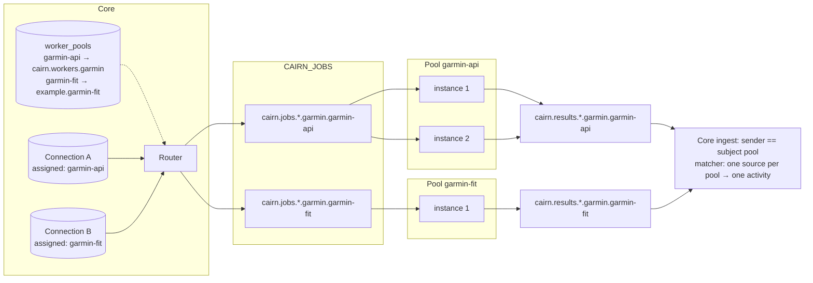
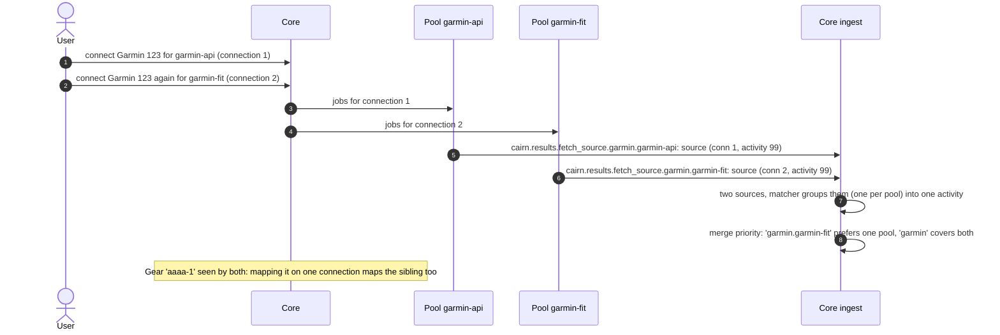
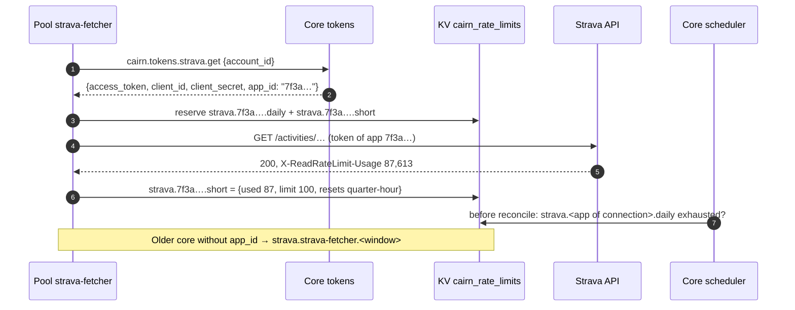
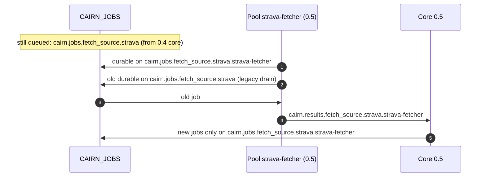

# Worker routing flows

How core and provider workers talk, as sequence and flow diagrams. They
complement the [provider contract](/architecture/provider-contract): the
contract states the rules, these show them in motion. A **pool** is every
worker instance sharing one `worker_name` for one provider; a pool name is
permanent and bound to one package.

| Channel | Subject or key |
| --- | --- |
| Jobs | `cairn.jobs.<job>.<provider>.<worker_name>` |
| Results | `cairn.results.<job>.<provider>.<worker_name>` |
| Discovery | `cairn.discover.<provider>.<worker_name>` |
| Account lookup | `cairn.accounts.lookup.<provider>.<worker_name>` |
| Core release | KV `cairn_core/info` |
| Rate budgets | KV `cairn_rate_limits/<provider>.<app>.<window>` |

## Routine import of an account

The scheduler sends the reconcile to the account's pool. An unassigned
account takes the provider's only _known_ pool (the registry, not whoever
happens to be online) and is then assigned to it. The worker sends its own
`fetch_source` sub-jobs to its own pool and archives every parser input. Core
checks each result against the sender's name on the subject, the pool's
package, and the account's pool.

```mermaid
sequenceDiagram
  autonumber
  participant S as Core scheduler
  participant R as Core router
  participant Q as CAIRN_JOBS (work queue)
  participant W as Pool strava-fetcher
  participant B as Object store
  participant I as Core ingest
  S->>R: reconcile account A
  R->>R: A.assigned_worker_name, else the only registered pool (persisted)
  R->>R: budget gate: cairn_rate_limits/strava.<app>.daily not exhausted
  R->>Q: cairn.jobs.reconcile.strava.strava-fetcher
  Q->>W: deliver (one durable per subject, shared by all instances)
  W->>Q: cairn.jobs.fetch_source.strava.strava-fetcher (per new activity)
  Q->>W: deliver fetch_source
  W->>W: fetch activity, streams, gear (token reply carried app_id)
  W->>B: archive envelope {version: dataset 1, activity, streams, gear}
  W->>I: cairn.results.fetch_source.strava.strava-fetcher (worker_version 1.1, release v0.5.0)
  I->>I: subject pool == worker_name; registry: name bound to package
  I->>I: account A is served by strava-fetcher; parser version not lower
  I->>I: ingest, recluster, merge, follow-ups
```

## Pool registry, retirement and reassignment

A pool is registered the first time its manifest or a result arrives; the
name is then bound to that package. Admins retire a pool: it leaves routing
and pickers, the name stays reserved, and the same package coming back
un-retires it. The owner of a connection may move it to another pool: free
within a package, with confirmation across packages, which flags the
connection's activities `pool_changed` for a re-fetch.



## Re-parse while a pool is mid-upgrade

Core picks the newest live parser of the source's own package and dataset,
and puts the source's current parser version in the job. An older instance
that still pulls the job hands it back with growing delay; after ten
deliveries it reports `parser_too_old`, and core keeps the source flagged
instead of failing it. Core refuses any result that would lower the version.

```mermaid
sequenceDiagram
  autonumber
  actor U as User
  participant C as Core
  participant Q as CAIRN_JOBS
  participant O as Instance (parser 1.1)
  participant N as Instance (parser 1.2)
  U->>C: Re-parse source (parsed by 1.2)
  C->>C: newest live parser of the package and dataset, >= 1.2
  C->>C: source.reimport_status = updating
  C->>Q: cairn.jobs.parse_blob.garmin.garmin-fetcher {min_parser_version: "1.2"}
  Q->>O: deliver
  O-->>Q: NAK, delay 30s·2^n up to 10 min (parser_too_old)
  Q->>N: redeliver (any instance of the pool)
  N->>C: cairn.results.parse_blob.garmin.garmin-fetcher (worker_version 1.2)
  C->>C: result package == source package; 1.2 >= 1.2; source updated
  Note over O,C: Only old instances for ~1 hour (10 deliveries):
  O->>C: failure envelope code parser_too_old on the pool's result subject
  C->>C: source back to update_available / newer_parser (not failed)
```

## Two worker implementations for one provider

Each pool has its own job and result subjects, so the work queue never sees
overlapping consumers and a pool cannot publish as another. The matcher
allows one source per _pool_, so an API import and a FIT import of the same
ride cluster into one activity. A merge priority entry may name a pool as
`garmin.garmin-fit`; a bare `garmin` covers every pool.



## Two connections for one provider account

A provider account may be connected once per pool; a pool the user does not
want is simply not connected. Each connection has its own sync state, queue,
tokens and app. A gear id decided on one connection maps the sibling's
reference too.



## Webhook event to account

A webhook names the provider's owner id. The worker asks on its own pool's
lookup subject; the subject (which it is permitted to publish on) names the
pool, so core returns that pool's connection and another pool cannot look it
up. A connection without a pool matches any pool.

```mermaid
sequenceDiagram
  autonumber
  participant P as Strava (app of connection 1)
  participant H as Core HTTP /webhooks/strava
  participant W as Pool strava-fetcher
  participant L as Core lookup (wildcard responder)
  P->>H: event {owner_id: 123, subscription_id: 5}
  H->>W: cairn.webhooks.strava-fetcher-strava.event
  W->>L: request cairn.accounts.lookup.strava.strava-fetcher {external_id, subscription_id}
  L->>L: pool from subject; connection of (strava, 123) assigned to strava-fetcher
  L-->>W: {account_id, user_id}
  W->>W: enqueue cairn.jobs.fetch_source.strava.strava-fetcher
  Note over P,W: A second pool on another app gets its own webhook; the same athlete on that pool is its own connection
```

## Rate budgets per provider app

OAuth apps belong to connections, and one pool serves many of them. Core
names the app in the token reply (`app_id`, a hash of the client id); the
worker attributes usage headers, 429s and reservations to that app's buckets.
Core reads the same keys to gate reconcile and to show the budget per
connection. A token without an app id falls back to the pool's bucket.



## Release compatibility

Core publishes its release in the `cairn_core` KV bucket (workers can only
read it). Before 1.0 a worker needs the same major.minor. From 1.0 on, minor
and patch releases are backwards compatible: same major, and the worker's
minor not above core's. A worker refuses to start, and stops on its next
heartbeat, against an incompatible core; core also flags such workers and
ignores them for re-parse and gear routing. Untagged builds skip the check.

```mermaid
sequenceDiagram
  autonumber
  participant C as Core
  participant K as KV cairn_core/info
  participant W as Worker
  C->>K: put {"release": "<core release>"} at startup
  W->>K: get info at start and on every heartbeat
  Note over W: 0.x: core v0.5.2 — worker v0.5.9 ok, v0.4.3 exit, v0.6.0 exit
  Note over W: 1.x: core v1.3.0 — worker v1.1.4 ok, v1.3.9 ok, v1.4.0 exit, v2.0.0 exit
  W->>W: incompatible → exit; compatible → serve
  W->>C: presence {version: "1.1", release: "<worker release>"}
  C->>C: compatible → eligible for routing; else flagged in admin, ignored
```

## Upgrade from 0.4: draining queued jobs

Jobs queued on the old provider-only subjects before the upgrade are not
lost: the permission template still lets the pool subscribe to them with its
old durable name. Results and lookups are pool-scoped only. The grant was
meant to last one minor release but is still present in 0.6.0; a later
release removes it.



## Bulk re-parse after a parser release

A new parser flags every source of its pool and dataset as
`update_available / newer_parser`; a new dataset flags `newer_dataset`
(re-fetch only). The Connections page shows the counts, and one action
re-parses up to 500 sources without provider quota.

```mermaid
sequenceDiagram
  autonumber
  participant W as Pool (parser 1.2)
  participant M as Core manifest watcher
  participant D as DB
  actor U as User
  participant C as Core
  W->>M: manifest {provider, package, version "1.2"}
  M->>D: worker_pools upsert; sources of the package with parser < 1.2 → update_available / newer_parser
  U->>C: POST /api/accounts/{id}/reparse-out-of-date
  C->>C: for each flagged source with an archive: re-parse by the newest live parser of the package
  C-->>U: {queued, skipped, remaining}
  Note over U,C: newer_dataset sources are listed as "need a re-fetch"
```
